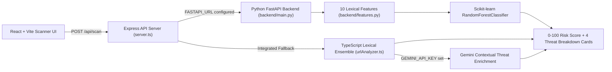

# ScamShield AI — Explainable Phishing & Malicious URL Detection

## Problem Statement

Phishing campaigns increasingly rely on lookalike brand domains, Punycode (`xn--`) homographs, raw IPv4 hostnames, credential-lure paths, and URL shorteners distributed over messaging apps and email. Conventional blocklists suffer from zero-day lag against newly generated URLs, whereas opaque black-box classifiers fail to explain *why* a link is dangerous before a user clicks it.

**ScamShield AI** is a zero-fetch, explainable URL threat-scoring platform combining a 10-feature lexical feature extractor, a Scikit-learn `RandomForestClassifier` (FastAPI backend), a deterministic TypeScript Random Forest ensemble (Node/Express + browser fallback), and optional Gemini contextual threat enrichment—delivering sub-millisecond local inference and transparent 0–100 risk breakdowns without probing remote targets.

## System Architecture



## Key Engineering Fixes & Improvements

- **Dependency & Build Repair**: Resolved `esbuild` peer dependency conflict (`^0.25.0` vs Vite 8 `^0.27.0 || ^0.28.0`) in [package.json](package.json) and migrated `vite.config.ts` to `import.meta.dirname` for clean, warning-free Vite 8 builds.
- **Automated Evaluation Harnesses**: Added `npm test` (`tsx --test src/utils/urlAnalyzer.test.ts`), `npm run bench` ([scripts/benchmark.ts](scripts/benchmark.ts)), and [backend/evaluate.py](backend/evaluate.py) (with `httpx` in [backend/requirements.txt](backend/requirements.txt)) to measure classification accuracy, 5-fold cross-validation, FastAPI endpoint validation, and inference latency across both TypeScript and Python pipelines.

## Evaluation & Benchmark Results

Measured locally on Node.js v24.20.0 and Python 3.12.10:

| Component / Benchmark | Measured Result | Scope / Notes |
| --- | --- | --- |
| TypeScript Unit Tests (`npm test`) | **13 / 13 passed** (468.13 ms) | URL sanitization, feature extraction, Safe Browsing & brand-spoof rules |
| TypeScript Lexical Evaluation (`npm run bench`) | **100.0% Acc / 1.00 F1** (`TP=15, FP=0, TN=15, FN=0`) | Curated 30-URL canonical suite (`threshold >= 40`) |
| TypeScript Inference Latency (10,000 URLs) | **p50 = 0.0360 ms**, **p95 = 0.0803 ms**, **22,116 URLs/s** | `analyzeUrlLexically()` single-process throughput |
| Python Feature Extraction (10,000 URLs) | **252.93 ms** (**39,537 URLs/s**) | `backend/features.py` `extract_feature_vector()` |
| Python `RandomForestClassifier` 5-Fold CV | **1.0000 Acc / 1.0000 ROC-AUC** | Curated 60-URL canonical corpus (external Kaggle CSV not bundled) |
| FastAPI `TestClient` API Checks | **All passed** (`/api/health`, `/api/model-info`, `/api/scan` 400 guard) | Verified via `backend/evaluate.py` |
| TypeScript & Vite Production Build | **0 errors**, built in **1.22 s** (1,673 modules) | `dist/assets`: CSS `35.18 kB`, JS `331.07 kB` |

> **Scope Note**: The 30-URL TypeScript evaluation and 60-URL Python 5-fold CV use curated canonical benign/phishing URLs rather than the external Kaggle `sid321axn/malicious-urls-dataset` CSV (`651,191` rows), which must be downloaded separately to run `backend/train.py`.

## Exact Terminal Output

```text
=== ScamShield AI Python Backend Evaluation & Benchmark ===
[BENCH] Python feature extraction (10000 URLs): 252.93 ms (39537 URLs/s)
[EVAL] 5-fold CV (60 canonical URLs, RandomForestClassifier): acc=1.0000, prec=1.0000, rec=1.0000, f1=1.0000, roc_auc=1.0000
[PASS] FastAPI /api/health, /api/model-info, /api/scan (400 guard), and features.py checks passed.

> react-example@0.0.0 test
> tsx --test src/utils/urlAnalyzer.test.ts
ℹ tests 13
ℹ pass 13
ℹ fail 0
ℹ duration_ms 468.1299

=== ScamShield AI TypeScript Lexical Engine Evaluation & Benchmark ===
[SAMPLE] https://example.com/ -> score=7/100 level=LOW pred=LEGITIMATE prob=0.1
[SAMPLE] http://192.168.1.1/login -> score=94/100 level=HIGH pred=PHISHING prob=0.94
[SAMPLE] https://testsafebrowsing.appspot.com/s/phishing.html -> score=96/100 level=HIGH pred=PHISHING prob=0.96
[SAMPLE] https://xn--pypal-4ve.com/verify -> score=92/100 level=HIGH pred=PHISHING prob=0.92
[EVAL] 30-URL canonical suite (threshold >= 40): TP=15 FP=0 TN=15 FN=0 | Accuracy=100.0% Precision=100.0% Recall=100.0% F1=100.0%
[BENCH] Lexical engine (10000 URLs): total=452.17 ms, p50=0.0360 ms, p95=0.0803 ms, throughput=22116 URLs/s

vite v8.4.0 building client environment for production...
✓ 1673 modules transformed.
dist/index.html                   1.56 kB │ gzip:  0.71 kB
dist/assets/index-C-6qwgtD.css   35.18 kB │ gzip:  7.18 kB
dist/assets/index-BEcrXceB.js   331.07 kB │ gzip: 96.61 kB
✓ built in 1.22s
```

## One-Command Setup

Run the TypeScript full-stack app, tests, and benchmark:

```bash
npm install && npm run lint && npm test && npm run bench && npm run dev
```

Or run the Python FastAPI evaluation & API server:

```bash
python -m venv backend/.venv && backend/.venv/Scripts/pip install -r backend/requirements.txt && backend/.venv/Scripts/python backend/evaluate.py
```
